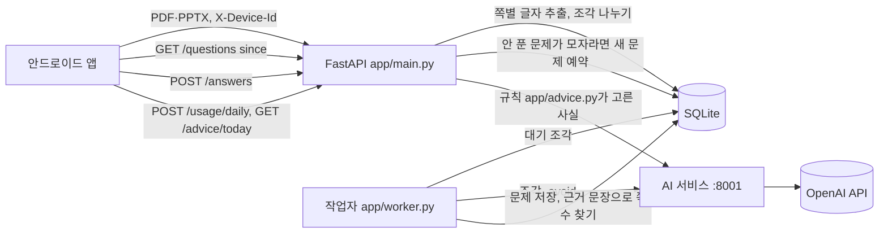

# WOOWANGTHON_TEAM_23_BE

스크롤 메이트의 API 서버. 앱이 올린 PDF·PPTX에서 쪽(슬라이드)별 글자를 뽑아 약 2000자 조각으로 나누고, 조각마다 AI 서비스를 불러 문제(OX 3개, 단답 2개)를 만들어 저장함. 앱은 만들어진 문제를 내려받아 쇼츠 위 카드로 띄움. 쇼츠 시청 기록의 하루 합계로 오늘의 한마디도 만듦.

- 서비스 소개, 전체 구조, API 계약: [DOCS](https://github.com/woowangthon/WOOWANGTHON_TEAM_23_DOCS) (`README.md`, `architecture.md`, `api.md`)
- 앱: [FE](https://github.com/woowangthon/WOOWANGTHON_TEAM_23_FE) · AI 서비스: [AI](https://github.com/woowangthon/WOOWANGTHON_TEAM_23_AI)
- 배포 주소: <https://scrollmate-be.fly.dev> (브라우저로 여는 화면은 없음. 확인은 `/api/v1/health`)

## 구조



Fly.io에서는 BE와 AI 서비스가 한 컨테이너에 프로세스 2개로 뜸. 외부에는 BE(8080)만 열리고 AI(8001)는 컨테이너 안에서만 접근함.

| 엔드포인트 | 하는 일 |
|---|---|
| `POST /api/v1/materials` | 파일 1~5개를 받아 글자를 뽑고 조각을 작업 큐에 넣음. `202`로 바로 응답 |
| `GET /api/v1/materials` | 자료별 상태(`processing`, `ready`, `failed`), 처리한 조각 수, 문제 수 |
| `DELETE /api/v1/materials/{id}` | 자료와 글자, 조각, 문제, 풀이 결과, 신고를 함께 지움 |
| `GET /api/v1/questions?since=` | 기기에 내려받을 문제. `since` 이후 새로 생긴 것만 |
| `POST /api/v1/answers` | 풀이 기록 저장, 새 문제 채우기 예약 |
| `POST /api/v1/questions/{id}/grade` | 단답 글자 비교 채점(앱도 같은 방식으로 기기에서 채점함) |
| `POST /api/v1/questions/{id}/report` | 문제 신고 |
| `POST /api/v1/usage/daily` | 쇼츠 시청 기록 하루 합계 저장 |
| `GET /api/v1/advice/today` | 오늘의 한마디 |
| `GET /api/v1/health` | 상태 확인 |

- `app/main.py`: 엔드포인트, 파일·횟수 제한, 새 문제 채우기
- `app/extract.py`: PDF(pypdf)·PPTX(python-pptx) 글자 추출, 조각 나누기, 근거 문장으로 쪽수 찾기
- `app/worker.py`: 문제 생성 작업자 1개
- `app/advice.py`: 오늘의 한마디로 말할 사실을 고르는 규칙
- `app/db.py`: SQLite 스키마

## 처리 방식

### 문제 생성

- 작업자 1개가 조각 번호 순으로 골라 자료마다 번갈아 처리함. 여러 자료를 올려도 모든 자료가 첫 문제를 빨리 받음
- 만들어지는 대로 저장하므로 처리 중인 자료도 문제를 내려받을 수 있음
- AI 호출이 실패한 조각은 3번까지 시도하고, 계속 실패하면 실패로 표시함
- AI가 돌려준 근거 문장을 쪽별 원문에서 찾아 쪽수를 붙임. 못 찾으면 `null`

### 새 문제 채우기

- 앱이 `POST /answers`로 풀이 기록을 보내면, 그 자료에서 한 번도 안 푼 문제가 5개 미만일 때 새 문제를 만듦
- 자료의 조각을 돌아가며 고르고, 그 조각에서 이미 낸 문제를 AI에 `avoid`로 넘김. 받은 뒤에도 유형·근거 문장·정답이 같거나 문제 문장이 85% 이상 같으면 버림
- 자료당 최대 10번, 한 번에 1건만 예약. 서버 전체 하루 생성 조각 한도에 포함됨

### 오늘의 한마디

- 앱은 기기에 쌓은 쇼츠 시청 기록의 하루 합계만 보냄(본 시간, 넘긴 횟수, 카드 결과 수, 밤 12시 이후 비중). 영상 정보는 없음
- 최근 7일 중 어제(없으면 가장 최근 날) 기록에서 규칙이 말할 사실 하나를 고름. 순서는 밤 12시 이후 비중 30% 이상, 20분 이상 이어 보기, 카드 절반 이상 건너뜀, 푼 카드와 맞힌 카드, 시청 시간과 넘긴 횟수
- AI는 고른 사실을 문장으로만 바꿈. 기기마다 하루 한 번 만든 문장을 저장해 다시 줌. AI가 실패하면 사실을 나열한 문장을 주고 저장하지 않음

## 기술 선택

| 결정 | 이유 | 다른 선택지 |
|---|---|---|
| Python, FastAPI | PDF·PPTX 글자 추출과 AI 호출을 같은 언어로 처리함. AI 서비스와 도구(uv, pytest)를 맞춤 | Spring Boot |
| SQLite, 프로세스 안 작업자 1개 | 서버 1대, 생성 작업은 AI 호출 대기가 대부분이라 한 번에 하나씩 처리해도 충분함. 큐와 DB를 따로 운영하지 않아도 됨 | Postgres, Redis 큐 |
| 문제를 미리 만들어 기기에 저장 | 카드가 뜨는 순간에 AI를 부르면 늦고 네트워크가 없으면 못 뜸 | 카드 표시 때 생성 |
| 쪽수는 BE가 찾음 | AI는 쪽 정보를 다루지 않고 근거 문장만 돌려주면 됨. 원문 대조로 근거가 실제로 있는지도 함께 확인됨 | AI에 쪽수까지 요청 |
| 로그인 없이 `X-Device-Id`와 횟수 제한 | 제출 기간 안에 로그인과 시연 흐름을 함께 바꾸기 어려움(BE #5). 기기·IP·서버 전체 한도로 OpenAI 비용을 묶음 | 구글 로그인 |
| Fly.io 한 컨테이너 | 심사 종료까지 서버를 계속 띄워야 함. BE와 AI를 같이 배포하면 내부 통신을 외부에 열지 않아도 됨 | Mac에서 실행하고 터널로 공개(폐기) |

## 실행 방법

Python 3.12, 패키지는 uv로 관리함. AI 서비스를 먼저 띄움(AI 레포 README).

```bash
uv sync
AI_URL=http://localhost:8001/internal/v1 uv run uvicorn --factory app.main:create_app --port 8080
```

- `AI_URL`: AI 서비스 주소. 기본값은 위와 같음
- `BE_DB_PATH`: SQLite 파일 위치. 기본값 `data/be.sqlite3`

확인:

```bash
curl localhost:8080/api/v1/health
curl -H "X-Device-Id: local-test" -F "files=@sample.pdf" localhost:8080/api/v1/materials
curl -H "X-Device-Id: local-test" localhost:8080/api/v1/materials
curl -H "X-Device-Id: local-test" localhost:8080/api/v1/questions
```

시험용 PDF는 DOCS 레포 `test-materials/`에 있음.

테스트는 AI 서비스 없이 돎 (AI 응답을 테스트 안에서 정해 둠).

```bash
uv run pytest
```

## 배포 (Fly.io)

- 앱 `scrollmate-be`, 도쿄, 1대 512MB. SQLite는 볼륨 `be_data`(`/data`)에 저장함. 볼륨을 지우면 자료와 문제도 사라짐
- 빌드 때 AI 레포 `main`을 받아 옴(`Dockerfile`의 `AI_REF`)
- 모델은 `fly.toml`의 `OPENAI_MODEL`. 키는 저장소에 두지 않고 Fly 시크릿으로만 넣음

```bash
fly secrets set OPENAI_API_KEY=...
fly deploy --no-cache
curl https://scrollmate-be.fly.dev/api/v1/health
```

- 자동 배포는 쓰지 않음. 캐시를 쓰면 AI 레포를 받는 단계가 재사용되어 AI의 새 커밋이 반영되지 않으므로 `--no-cache`로 배포함
- 빌더가 응답하지 않으면 `fly deploy --no-cache --depot=false`로 Fly 원격 빌더를 씀
- 업로드한 자료의 글자는 OpenAI API로 전송됨

## 제한

| 항목 | 값 | 넘으면 |
|---|---|---|
| 한 번에 올리는 파일 | 1~5개 | `400 invalid_request` |
| 파일 크기, 쪽수 | 20MB, 100쪽(슬라이드) | `413 file_too_large` |
| 기기별 동시 처리 자료 | 5개 | `429 too_many_materials` |
| 기기별 하루 업로드 | 10개 | `429 rate_limited` |
| 전체 대기 조각 | 900개 | `429 rate_limited` |
| IP별 하루 업로드 (`Fly-Client-IP`, 배포 환경만) | 30개 (`BE_IP_DAILY_UPLOADS`) | `429 rate_limited` |
| 서버 전체 하루 생성 조각 | 2000개 (`BE_DAILY_CHUNKS`) | `429 rate_limited` |
| 요청 본문 | 101MB | `413 file_too_large` |
| PPTX 압축 해제 크기 | 200MB | `415 unsupported_file` |
| `X-Device-Id` 길이, 풀이 기록 한 번에 | 64자, 200개 | `400 invalid_request` |
| 시청 기록 한 번에 | 14일 | `400 invalid_request` |
| 기기별 하루 한마디 생성 시도 | 3번 | `429 rate_limited` |

스캔본처럼 글자를 뽑을 수 없는 파일은 `415 unsupported_file`. API 문서 화면(`/docs`)은 끔.

## 하지 않은 것

- 로그인. 기기 ID를 바꾸면 기기별 한도를 피할 수 있어 IP와 서버 전체 한도를 함께 둠
- 정답 검증 호출(AI `verify`)은 생성 흐름에 넣지 않음
- 오답노트 API, 인스타그램 릴스
